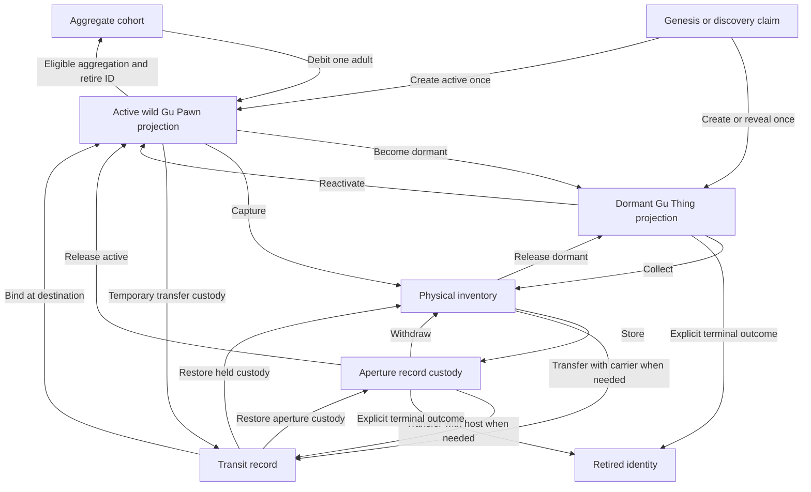

# RFC-0002 — Individual Gu identity and custody

**Status** — Slice 3B implemented. The owner reported a rendered pass for the controlled lifecycle. The ordinary inventory follow-up and merge decision remain tracked separately.
**Target** — RimWorld 1.7 / Waylith / .NET 10
**Branch** — `feature/spirit-spring-ecology-visual-overhaul`

## 1. Scope and existing code

Gu are living creatures. An active wild Gu should be able to move, interact, and feed under its own behavior. The same Gu may become a selectable dormant object, be carried, or live inside an aperture. Contained individuals should incur no Pawn AI cost. Dormancy is a biological condition, while custody describes where the Gu is and who can access it. A captured Gu can remain awake while contained.

Slice 3 would prove identity, active and dormant manifestations, and controlled custody transfers with development fixtures. Full ecology, cultivation UI, feeding systems, and combat abilities are later work. The above-ground spirit spring remains a validated development prototype.

- [GuSpeciesDef](../Source/ProjectGu/Domain/GuSpeciesDef.cs) supplies species metadata. Keep it as the catalog and add optional behavior configuration only when a fixture needs it.
- [CompGuSpiritSpring](../Source/ProjectGu/Springs/CompGuSpiritSpring.cs) owns its cohort list. [GuPopulationLedger](../Source/ProjectGu/Springs/GuPopulationLedger.cs) provides local operations. Keep those cohorts in place and add a checked debit/credit boundary when materialization is introduced.
- [Hediff_Aperture](../Source/ProjectGu/Hediff_Aperture.cs) already owns cultivation rank and essence. Preserve its save fields. An aperture can expose a custody endpoint without deep-saving a second list of Gu records.
- [GuWorldComponent](../Source/ProjectGu/GuWorldComponent.cs) is a GameComponent for cultivator records and discovery. Keep Gu persistence separate from pawn discovery and the existing humanlike eligibility check. Beast cultivation and biological hosting need their own eligibility rules.
- [GuAwakeningService](../Source/ProjectGu/GuAwakeningService.cs) commits completed natural outcomes with a checked adult Hope Gu debit. The [native awakening fixture](IMPLEMENTATION-0.2.5.md#phase-b-awakening-conservation) verifies the narrow cohort boundary.

## 2. Slice 3 storage decision

The recommendation draws on the installed Windows RimWorld 1.7.5014 rev1195 assembly and the Phase E/F native fixtures. The engine findings below come from method inspection. The fixture results cover the existing persistence seams and give Slice 3 concrete cases to reproduce with individual Gu. [Phase F evidence](IMPLEMENTATION-0.2.5.md#phase-f-focused-regression).

| Model | RimWorld 1.7 evidence | Consequence |
|---|---|---|
| Pawn-owned | `Pawn.ExposeData` deep-saves health, inventory, jobs and other trackers. `WorldPawnsTick` ticks active world Pawns, and the world-pawn lifecycle includes mothballing and GC. `Pawn.Destroy` can pass a Pawn to the world. | Native Pawn identity fits an active Gu. A held or mothballed Pawn would still retain a Pawn graph per Gu, with additional disposal and world-pawn membership cases to prove. |
| Thing-owned | `Pawn_InventoryTracker.ExposeData` deep-saves its `ThingOwner`. The cargo fixtures verified the same native item through holding, cross-map travel and reload. `ThingWithComps` exposes save, despawn and destruction hooks. | A non-stackable Thing fits physical inventory. An active Pawn would need to carry or reference a persistent backing item or transfer identity at every manifestation change. |
| Record-owned | `ScribeLoader.FinalizeLoading` resolves cross-references before post-load initialization. `Game.LoadGame` finalizes maps and map parents before `GameComponent.LoadedGame`. The existing independent site records and hauling references survive a fresh-process load. | A dedicated GameComponent can keep identity across swaps. A post-load binding pass must validate referenced Pawns, Things and apertures against the live engine graph. |

**Recommendation** — Deep-save a versioned `GuIndividual` in a dedicated GameComponent. Give it an immutable ID, species Def key, rank, origin and provenance, biological condition, optional nourishment state, refinement relationship, and one custody descriptor. Keep biology and refinement independent of the custody transition. A native Pawn represents an active wild Gu and an unstackable Thing represents a dormant ground Gu or a captured Gu in a native inventory. Each projection carries the Gu ID and binding revision. The record authorizes the binding and custody state. Use the engine graph for physical position and actual holder.

For aperture custody, index records by host Pawn and aperture instance. The installed engine saves a Hediff `loadID`, exposes `GetUniqueLoadID`, and calls `PostRemoved` on explicit removal. Probe the saved Pawn and Hediff pair and test host death and aperture replacement separately. Mark unresolved custody inspectable and non-interactable while retaining the ID. Build indexes after map and holder references have resolved. Aperture contents use only records, and optional species updates can be scheduled by due time. Allocate native Pawns for active manifestations.

### First vertical slice

Slice 3A proved the native seams with disposable fixtures. The wild Pawn retirement probe observed no kill, corpse creation or surviving world-pawn entry, and it observed one native discard cleanup callback. A spawned Thing belonged to the map's native holder, and an inventory Thing resolved through its exact Pawn inventory. The exact Pawn and Hediff pair survived travel and reload. Both compatibility regressions passed on the Slice 3A checkpoint. [Probe and regression results](IMPLEMENTATION-0.2.5.md#slice-3a-checkpoint--native-engine-probes).

### Slice 3B implementation plan

Use one developer species, one aperture slot and controlled Development Mode actions to prove **Wild → Dormant → Captured → Stored in aperture → Released**. Include a small readout for the Gu ID, revision and current holder.

1. **Save and bind one record.** Add the versioned record and indexes by Gu ID and holder. An older save starts with an empty individual registry. Preserve raw species and binding keys if an endpoint fails to resolve. After native map and holder loading, validate the exact projection and revision before enabling interaction. Keep one recoverable record for an ambiguous or missing binding.
2. **Prove retirement on the actual Gu projection.** Check that the expected native Pawn is the current map-owned projection. Limit the initial path to an empty wild Pawn with no faction, quest, social or ownership obligations. Preflight placement and prepare the dormant Thing inert. Use reversible despawn while verifying the handoff, and respawn the same Pawn if staging fails. Once the record commits the new binding, discard the old Pawn under a transition guard. Test reentrant callbacks and any supported DLC notifications. A cleanup exception must block duplicate interaction and leave enough evidence for recovery without repeating the discard blindly. [Native retirement limits](IMPLEMENTATION-0.2.5.md#native-retirement-limits).
3. **Complete the held and aperture moves.** Capture the same unstackable Thing into the exact Pawn inventory using native holder APIs. Support placing it back into the map's native holder. Storing validates the live host, the exact Hediff instance and available capacity before removing the physical projection. Withdrawal prepares a Thing for native inventory. Release prepares an active Pawn on a valid cell and rebinds the same record. Host death or aperture removal keeps the ID in recoverable custody. A same-Def replacement requires an explicit new binding.
4. **Verify the transaction and its saves.** Use one coordinator with expected custody and revision, staged placement, a reentry guard and a single commit. Prove each synchronous transition is safe against save reentry before enabling it. Add a durable transition record if a supported operation can leave a save between ownership changes. Fresh-process reload each stable state and cross the existing passage with both inventory and aperture custody. Test replay, blocked release, full holders, missing routes, missing projections and aperture loss. Verify last-access removal through `IGuUndergroundCustodyProtection`, including a level whose protected occupant is the Gu. [Underground custody guard](../Source/ProjectGu/Underground/GuPocketProbeComponent.Recovery.cs).

5. **Verify conservation and compatibility.** After the full round trip works, materialize one adult from a developer-species cohort through a checked debit and stable event key. Prove the cohort count plus its debit-backed non-retired individuals stays constant across retries and reload. Run the existing Awakening and CargoPrototype regressions and load disposable copies of the historical saves. Compare the same 120 hosts with empty apertures and with one record per aperture for save, load and tick cost. Aperture custody allocates zero Pawn or Thing projections.

Each new custody commit advances the binding revision once and copies it to the live projection when there is one. This includes wild-to-dormant as of Slice 3B-3B. Rejections, successful rollbacks, reload, and native passage travel preserve the revision. Earlier saves retain their recorded revision.

The native owner key is the Thing load ID for physical custody and the Hediff load ID for aperture custody. Inventory and aperture custody also save the exact holder Pawn's load ID. The aperture slot and indexes derive from the canonical registry, and each aperture holds at most one claim in this prototype. A quarantined claim retains its original pair and reserves that exact slot.

The active-release path stages the species-defined Pawn under the custody guard, verifies native placement and the return route, then commits and activates that Pawn. The map-local custody service derives protection from live registry bindings. The inventory route to active release has its own source Thing retirement and rollback requirements.

Slice 3B-5A debits one adult from a habitat-owned cohort at an expected revision. The canonical individual saves the event key, exact source provenance, and evidence of the debit. A quarantined record with a committed debit still counts toward conservation. An undebited quarantine blocks its event and leaves the population unit in the cohort.

Slice 3B-5B joins materialization to the full custody lifecycle in the native game. The same cohort-origin ID persists through wild, dormant, inventory, aperture and released wild custody at revisions one through five. The performance fixture compares equal populations of 120 real aperture hosts with zero and 120 authorized individual records. Each populated aperture holds one Gu. [Technical acceptance report](GU-FRAMEWORK-0.2.5-ACCEPTANCE.md)

## 3. Custody and transitions

The diagram shows committed endpoints. Biological activity, nourishment and refinement are separate from custody. Releasing from inventory or an aperture preserves identity. Returning to an aggregate is an explicit retirement permitted only for eligible cohorts and Gu with no state or uniqueness obligation requiring continued individuality.

Inventory can use a non-stackable contained Thing handle where the engine needs one. That handle may never run Gu AI. A sealed discovery with a predetermined individual holds its ID in sealed custody. A stone that creates an individual on opening instead owns a stable, once-only genesis claim until commit. Each discovery chooses one model. A failed reveal keeps the stone and claim intact.

## 4. Save/load and failure safety

**Stable endpoints.** Use a versioned list and explicit lifecycle state. Persist projection links and custody keys using verified Scribe support. Preserve unresolved Def names and recoverable fields. Read record data first, resolve cross-references, then reconcile against the restored map, world-pawn, and holder graph when 1.7 makes it safe. Gate ticking, interaction and projection creation until bindings are resolved. Retain invalid or ambiguous bindings for diagnosis and disable them. A missing projection triggers recovery from verified custody evidence or explicit quarantine. Reload alone grants no new cohort debit, genesis, allocation, or ID.

**Commit protocol.** All supported operations preflight source custody, expected revision, target capacity or placement, species policy, and costs. Reserve the source against reentry. Prepare any destination projection without allowing it to act. Commit the destination and corresponding source debit, claim, or detach as one coordinated operation. Expose the new projection and revision only after commit. Remove the old projection with a transition reason so its destruction callback cannot kill the Gu. If an engine operation can fail, require a reversible operation or a durable transfer endpoint. Record enough data to resume or roll back deterministically when a transition spans saves. Prove that synchronous steps cannot be serialized mid-commit, or treat them as durable transfers too.

**Failure outcomes.** Invalid target, cancellation and failed placement leave the source intact and remove any provisional object. A disappearing source or destination uses a predeclared recovery endpoint with the same ID. A transfer interrupted by reload resumes or rolls back by its ID and expected revision. A retry of a committed operation reports its prior result. Engine teardown and terminal death must be distinguishable. Terminal outcomes and genesis claims that need replay protection remain recorded even when an individual is retired. Invalid custody must be diagnosable in the log or dev UI.

**Conservation.** A cohort transfer moves one unit between aggregate and individual custody. Ordinary capture or release moves the same ID. Birth, refinement, mutation, discovery and ascension use explicit creation or transformation outcomes. Uniqueness is a checked key, such as species plus designed scope, covering active, dormant, sealed, contained, and transit records, including unresolved individuals. Reserve the key before genesis. Release it only according to a reviewed terminal policy. A repeated event key cannot allocate a new ID.

## 5. Aperture, feeding, and management UI

An aperture endpoint is bound to a persistent host and an aperture identity. Verify identity resolution across Hediff replacement and host travel. Aperture access, capacity and release eligibility depend on the host and species. Occupants are indexed from the canonical custody records. Host death, aperture loss, or a missing host triggers an explicit species/host outcome, with recoverable custody for unresolved cases. A beast host can offer an aperture or a separate biological host endpoint under explicit eligibility rules.

### Physical custody, refinement and aperture rules

Dormancy describes biological condition. Refinement allegiance has its own state, independent of condition and custody. Physical possession grants physical control of a Gu. Unrefined dormant Gu can be picked up and dropped through native inventory while the same canonical record authorizes each committed transfer.

Ordinary mortal-aperture storage requires appropriately refined Gu. Entry of an unrefined Gu for refinement is a distinct action and process with its own rules and outcomes. The current Development Mode storage and withdrawal are infrastructure fixtures for exact holder binding, save/load and conservation.

Immortal apertures and blessed lands are persistent internal physical environments. Refined and unrefined Gu can occupy those environments as dormant objects or active living creatures. Their physical custody identifies the environment or holder, and refinement allegiance remains a separate relationship.

Feeding uses optional per-species rules. A rule describes acceptable inputs or environmental exposure, scheduling, and outcomes such as nourishment, dormancy, recovery, or death. Use known tick intervals and bounded elapsed-time processing. Keep hunger state only where the species needs it. A feeding result accounts for the real source and quantity consumed, the feeding method, and the resulting individual state.

- **Direct feeding** uses a Gu row action to request real accessible food, with a pawn job or inventory debit at commit.
- **Facility feeding** uses a bench or formation to reserve inputs, provide its conditions, and commit on completion. Interruption leaves unspent inputs available.
- **Environmental feeding** checks exposure in the relevant custody or requires release through the standard transfer path. Conditions and any finite resources consumed are attributable to that interaction.

The eventual **Cultivation / Gu** tab shows aperture condition and essence, contained Gu, status and nourishment, refiner and custody, and valid feeding, capture, storage, release and ability actions. Eligible animals use the same read model with host-specific actions. Wild Pawn and dormant Thing inspection expose species, visible condition and relevant capture or interaction commands. Slice 3 needs a compact dev panel or inspect extension with ID, species, origin, current custody, condition, refiner, and available transfer actions. Every action calls the coordinator and displays its result. A list with 120 Gu needs filtering and bounded rendering. Full player jobs, menus, and utility actions follow their own slices.

## 6. Optional ability and ecology contracts

An ability declares participant selection (one or many distinct Gu IDs), authorized operator or autonomous trigger, target conditions, costs, and effect execution. Preflight snapshots the custody and availability of participants, then commit revalidates them before spending essence or other resources. An effect can operate on contained records. Custody changes or consumption require declared transition effects. Define outcome and cost handling for interrupted or failed effects before each ability ships. Specialized behavior implementations can cover combat, support, mobility, deduction, feeding, refinement and passive effects. Formations, killer moves and Gu Houses compose participants through the same selection and validation rules. Keep the first test effect observable and non-combat.

Habitat suitability is a separate species policy and can express soft preference or a hard requirement. A Gu can roam independently of a habitat object. Springs, Lingzhi forests, breeding towers and dao-mark conditions can bias occurrence and reproduction. Regional cohorts, biological hosts and independent individuals can all supply Gu through checked transfers. Reproduction, natural refinement, symbiosis, parasitism, mutation and exceptional ascension events submit explicit provenance and an idempotent creation or transformation request. Prefer sparse scheduling and environment snapshots. Contained Gu use batched due updates where required. Keep expensive pathing limited to active manifestations.

## 7. Underground-first sequencing and acceptance

1. **Review and schedule underground infrastructure first.** Plan the reusable pocket-map framework around an underground spirit spring cavern. Define stable site and endpoint keys, transfer completion and cancellation, unload and teardown, and failed destination recovery. Leave room for mining, shelters, inheritances, multiple depths, and Earth Abyss-style sites. Slice 3 implementation starts only after that infrastructure work has been reviewed and scheduled and this RFC is approved. Destruction or unloading of a map must not destroy an in-transit Gu. An underground transfer uses the same custody contract as surface travel. Release acceptance requires a real route, including a missing destination.
2. **Keep the Phase F baseline.** The installed Windows 1.7 build, native lifecycle, historical loads and awakening conservation passed. Rerun the relevant regression fixtures when adding a new cohort consumer. [Phase F evidence](IMPLEMENTATION-0.2.5.md#phase-f-focused-regression).
3. **Keep the Slice 3A evidence.** The native retirement, owner graph and exact aperture probes passed on the installed 1.7 build. Preserve those cases when adding production projections. [Slice 3A results](IMPLEMENTATION-0.2.5.md#slice-3a-checkpoint--native-engine-probes).
4. **Review and build the narrow vertical slice.** Use the [Slice 3B plan](#slice-3b-implementation-plan) to prove the same ID through all five states and native cross-map travel before adding controlled cohort materialization.
5. **Accept on evidence.** Run two save/reload cycles for each successful path, inject failures at each transition boundary, replay requests, test missing Def round-trips, and record conservation totals and IDs. Profile active and contained workloads on the target game and record memory, tick time and save/load time. Run baseline spring ecology, stone output and awakening regressions. Document the results and request review before advancing.

The following scenarios extend the first identity proof as species behavior, abilities and discovery are added.

| Scenario | Acceptance condition |
|---|---|
| Wild Liquor Worm | It moves and interacts while active. Capture, dormancy and store/release keep its ID, nourishment and refiner. Failed capture leaves one active Gu. |
| Gambling stone | Opening reveals one selectable dormant Gu. Blocked placement preserves the source, and reopening or reloading cannot duplicate the claim. |
| 120 mortal Fire Gu | There are 120 distinct saved IDs and zero active Pawns for the contained group. A test selection resolves distinct participants, and a failed cost preflight changes neither custody nor resources. Record performance at normal and accelerated speeds. |
| Wisdom Gu assisting deductions | The probe resolves the Gu in verified custody and applies a bounded, attributable support effect with no physical spawn or duplicate. |
| Aperture entry and exit | Held → aperture → release retains identity and refinement. Include a full destination, host death and aperture removal, with explicit outcomes. |
| Unique Immortal Gu | Competing creation sources and replay after reload cannot claim the same uniqueness key, including while the original is sealed, dormant or in transit. |
| Surface to underground | Forward and return trips preserve ID and state. Save in transit, unload the source, and reject an unavailable destination without cloning or losing the Gu. |

## 8. Open questions for independent review

- What Scribe phases are safe for reference resolution and projection binding across GameComponents, Hediffs, `ThingOwner`, world Pawns and pocket maps? Does a world Pawn survive or get culled on each supported route?
- Which 1.7 public lifecycle hooks expose pickup, split/merge, map removal, despawn, holder transfer and destruction reasons? The validated spring code uses `PostDestroy(DestroyMode, Map)`. Its unsupported `PostDeSpawn(Map)` signature is not a precedent for new hooks.
- Can active Pawn projections be disabled, detached or retired without corpses, duplicated world entries, relationship side effects, or lost durable injuries? Can a moving Thing fallback preserve the required living interactions?
- Can the engine serialize or dispatch reentrant callbacks during placement, holder moves, Hediff removal or map transfers? Which operations need saved transit intent?
- Is aperture identity stable across Hediff replacement and host travel? Which host-loss outcomes are required in the first implementation?
- What CPU, retention and save-size limits do 120 contained Gu and multiple active Gu meet on 1.7? Compare the prototype approaches before setting a budget.
- Which Immortal Gu uniqueness scopes and post-death rules are intended? Which species may aggregate, and which individual properties forbid retirement into a cohort?
- Does the underground plan expose a stable endpoint and a recoverable transfer protocol early enough for the acceptance gate?

**Suggested focus for independent review** — Challenge the proposed record authority at the engine custody boundary. Identify any transition that can leave two actionable manifestations, lose an individual, or debit resources twice. Review aperture host-loss and underground teardown cases in particular, then judge whether the alternative storage probes and acceptance gates would distinguish the viable designs.
