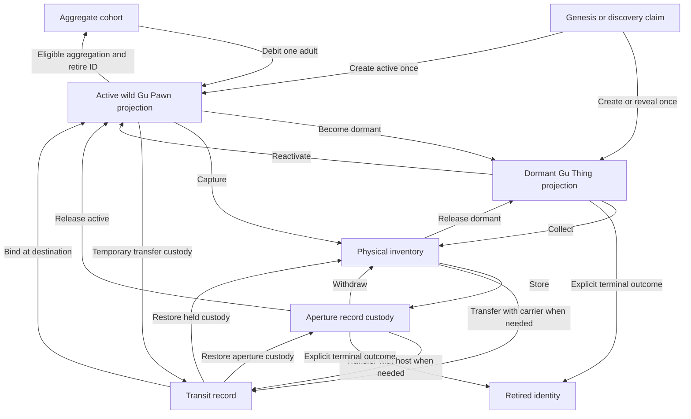

# RFC-0002 — Individual Gu identity and custody

**Status** — Proposed for owner approval. Independent Claude Opus review is optional.
**Target** — RimWorld 1.7 / Waylith / .NET 10
**Branch** — `feature/gu-framework-0.2.5`

## 1. Scope and existing code

Gu are living creatures. An active wild Gu should be able to move, interact, and feed under its own behavior. The same Gu may become a selectable dormant object, be carried, or live inside an aperture. Contained individuals should incur no Pawn AI cost. Dormancy is a biological condition, while custody describes where the Gu is and who can access it. A captured Gu can remain awake while contained.

Slice 3 would prove identity, active and dormant manifestations, and controlled custody transfers with development fixtures. Full ecology, cultivation UI, feeding systems, and combat abilities are later work. The above-ground spirit spring remains a validated development prototype.

- [GuSpeciesDef](../Source/ProjectGu/Domain/GuSpeciesDef.cs) supplies species metadata. Keep it as the catalog and add optional behavior configuration only when a fixture needs it.
- [CompGuSpiritSpring](../Source/ProjectGu/Springs/CompGuSpiritSpring.cs) owns its cohort list. [GuPopulationLedger](../Source/ProjectGu/Springs/GuPopulationLedger.cs) provides local operations. Keep those cohorts in place and add a checked debit/credit boundary when materialization is introduced.
- [Hediff_Aperture](../Source/ProjectGu/Hediff_Aperture.cs) already owns cultivation rank and essence. Preserve its save fields. An aperture can expose a custody endpoint without deep-saving a second list of Gu records.
- [GuWorldComponent](../Source/ProjectGu/GuWorldComponent.cs) is a GameComponent for cultivator records and discovery. Keep Gu persistence separate from pawn discovery and the existing humanlike eligibility check. Beast cultivation and biological hosting need their own eligibility rules.
- [GuAwakeningService](../Source/ProjectGu/GuAwakeningService.cs) currently commits the pawn outcome before checking the debit outcome. Verify a narrow fix separately before introducing another mature Hope Gu consumer.

## 2. Canonical storage

| Approach | Strength | Main risk |
|---|---|---|
| Pawn-owned | Engine naturally owns identity and AI while the Gu is active. | Dormant Things and aperture contents would need to retain the Pawn through world-pawn or holder lifecycles, or migrate ownership to another object. Measure retained Pawn memory, ticking, and culling. |
| Thing-owned | A non-stackable item can follow the normal ground, inventory and caravan save graph. | An active Pawn would need a persistent backing item or a handoff to another owner. Verify nesting, destruction, replacement, and map teardown before relying on it. |
| Representation-independent record | One save-backed record can survive swaps and represent an entire contained collection without Pawn instances. | Engine objects still have their own save and lifecycle graph. Binding order, stale projections, engine-side transfers and reconciliation need proof. |

**Recommendation, conditional on testing** — Prototype a dedicated GameComponent that deep-saves one versioned `GuIndividual` record per individual. Each record owns its immutable GUID, species key, rank, origin, persistent condition and species state, refinement relationship, and one custody descriptor. Index by ID and holder in memory. Use ordinary game saves for engine Pawn and Thing projections and for their physical placement in the engine graph. A projection saves the Gu ID and a binding revision, plus engine-required state. The engine may own transient pathing and job state. Gameplay properties that must survive projection replacement, such as durable injuries if supported, need one named authority or an explicit adapter mapping before adoption.

The record authorizes the endpoint and which projection may act. For physical custody, the engine graph supplies the observed map, cell, or holder. Avoid a parallel authoritative position or inventory list in the record. Bind the exact registered projection using verified load IDs or Scribe references. Reconcile mismatches before enabling interaction. Direct engine pickup, drop, travel, damage, and destruction need verified hooks or controlled interactions that cover every supported custody path.

Prototype Pawn-owned and Thing-owned alternatives against the same tests. If safe Pawn replacement cannot be demonstrated, try a lightweight moving Thing with scheduled behavior and explicit interactions, or retain a Pawn only for the active phase and reconstruct its projection from the record when reactivated. A moving Thing would need independent movement, feeding, interaction and pathing proof before it could satisfy the active Gu requirement. Literal object conversion is unnecessary. If no candidate preserves state and custody through the test matrix, stop before shipping the feature.

## 3. Custody and transitions

The diagram shows committed endpoints. Biological activity, nourishment and refinement are separate from custody. Releasing from inventory or an aperture preserves identity. Returning to an aggregate is an explicit retirement permitted only for eligible cohorts and Gu with no state or uniqueness obligation requiring continued individuality.

Inventory can use a non-stackable contained Thing handle where the engine needs one. That handle may never run Gu AI. A sealed discovery with a predetermined individual holds its ID in sealed custody. A stone that creates an individual on opening instead owns a stable, once-only genesis claim until commit. Each discovery chooses one model. A failed reveal keeps the stone and claim intact.

## 4. Save/load and failure safety

**Stable endpoints.** Use a versioned list and explicit lifecycle state. Persist projection links and custody keys using verified Scribe support. Preserve unresolved Def names and recoverable fields. Read record data first, resolve cross-references, then reconcile against the restored map, world-pawn, and holder graph when 1.7 makes it safe. Gate ticking, interaction and projection creation until bindings are resolved. Retain invalid or ambiguous bindings for diagnosis and disable them. A missing projection triggers recovery from verified custody evidence or explicit quarantine. Reload alone grants no new cohort debit, genesis, allocation, or ID.

**Commit protocol.** All supported operations preflight source custody, expected revision, target capacity or placement, species policy, and costs. Reserve the source against reentry. Prepare any destination projection without allowing it to act. Commit the destination and corresponding source debit, claim, or detach as one coordinated operation. Expose the new projection and revision only after commit. Remove the old projection with a transition reason so its destruction callback cannot kill the Gu. If an engine operation can fail, require a reversible operation or a durable transfer endpoint. Record enough data to resume or roll back deterministically when a transition spans saves. Prove that synchronous steps cannot be serialized mid-commit, or treat them as durable transfers too.

**Failure outcomes.** Invalid target, cancellation and failed placement leave the source intact and remove any provisional object. A disappearing source or destination uses a predeclared recovery endpoint with the same ID. A transfer interrupted by reload resumes or rolls back by its ID and expected revision. A retry of a committed operation reports its prior result. Engine teardown and terminal death must be distinguishable. Terminal outcomes and genesis claims that need replay protection remain recorded even when an individual is retired. Invalid custody must be diagnosable in the log or dev UI.

**Conservation.** A cohort transfer moves one unit between aggregate and individual custody. Ordinary capture or release moves the same ID. Birth, refinement, mutation, discovery and ascension use explicit creation or transformation outcomes. Uniqueness is a checked key, such as species plus designed scope, covering active, dormant, sealed, contained, and transit records, including unresolved individuals. Reserve the key before genesis. Release it only according to a reviewed terminal policy. A repeated event key cannot allocate a new ID.

## 5. Aperture, feeding, and management UI

An aperture endpoint is bound to a persistent host and an aperture identity. Verify identity resolution across Hediff replacement and host travel. Aperture access, capacity and release eligibility depend on the host and species. Occupants are indexed from the canonical custody records. Host death, aperture loss, or a missing host triggers an explicit species/host outcome, with recoverable custody for unresolved cases. A beast host can offer an aperture or a separate biological host endpoint under explicit eligibility rules.

Feeding uses optional per-species rules. A rule describes acceptable inputs or environmental exposure, scheduling, and outcomes such as nourishment, dormancy, recovery, or death. Use known tick intervals and bounded elapsed-time processing. Keep hunger state only where the species needs it. A feeding result accounts for the real source and quantity consumed, the feeding method, and the resulting individual state.

- **Direct feeding** uses a Gu row action to request real accessible food, with a pawn job or inventory debit at commit.
- **Facility feeding** uses a bench or formation to reserve inputs, provide its conditions, and commit on completion. Interruption leaves unspent inputs available.
- **Environmental feeding** checks exposure in the relevant custody or requires release through the standard transfer path. Conditions and any finite resources consumed are attributable to that interaction.

The eventual **Cultivation / Gu** tab shows aperture condition and essence, contained Gu, status and nourishment, refiner and custody, and valid feeding, capture, storage, release and ability actions. Eligible animals use the same read model with host-specific actions. Wild Pawn and dormant Thing inspection expose species, visible condition and relevant capture or interaction commands. Slice 3 needs a compact dev panel or inspect extension with ID, species, origin, current custody, condition, refiner, and available transfer actions. Every action calls the coordinator and displays its result. A list with 120 Gu needs filtering and bounded rendering. Full player jobs, menus, and utility actions follow their own slices.

## 6. Optional ability and ecology contracts

An ability declares participant selection (one or many distinct Gu IDs), authorized operator or autonomous trigger, target conditions, costs, and effect execution. Preflight snapshots the custody and availability of participants, then commit revalidates them before spending essence or other resources. An effect can operate on contained records. Custody changes or consumption require declared transition effects. Define outcome and cost handling for interrupted or failed effects before each ability ships. Specialized behavior implementations can cover combat, support, mobility, deduction, feeding, refinement and passive effects. Formations, killer moves and Gu Houses compose participants through the same selection and validation rules. Keep the first test effect observable and non-combat.

Habitat suitability is a separate species policy and can express soft preference or a hard requirement. A Gu can roam independently of a habitat object. Springs, Lingzhi forests, breeding towers and dao-mark conditions can bias occurrence and reproduction. Regional cohorts, biological hosts and independent individuals can all supply Gu through checked transfers. Reproduction, natural refinement, symbiosis, parasitism, mutation and exceptional ascension events submit explicit provenance and an idempotent creation or transformation request. Prefer sparse scheduling and environment snapshots. Contained Gu use batched due updates where required. Keep expensive pathing limited to active manifestations.

## 7. Underground-first sequencing and acceptance

1. **Review and schedule underground infrastructure first.** Plan the reusable pocket-map framework around an underground spirit spring cavern. Define stable site and endpoint keys, transfer completion and cancellation, unload and teardown, and failed destination recovery. Leave room for mining, shelters, inheritances, multiple depths, and Earth Abyss-style sites. Slice 3 implementation starts only after that infrastructure work has been reviewed and scheduled and this RFC is approved. Destruction or unloading of a map must not destroy an in-transit Gu. An underground transfer uses the same custody contract as surface travel. Release acceptance requires a real route, including a missing destination.
2. **Close the baseline build gate.** Run `scripts/verify.ps1` against the actual Windows 1.7 assemblies. Verify Slice 2 save integrity, spring lifecycle, and awakening regressions before adding another cohort consumer. Maintain existing save keys and behavior. The local audit verified structural checks and domain arithmetic. It could not confirm the game-linked build or Scribe.
3. **Prove the storage decision.** After approval and scheduling, compare minimal persistence probes for record-, Pawn-, and Thing-owned designs. Round-trip ground, dormant, held, caravan, aperture and transit cases, with pending references and forced failure. Capture the exact tested game build, APIs, callback ordering and log results.
4. **Build the narrow vertical slice.** Use a small test species with active movement and an attributable feeding interaction, a dormant reveal, and the same individual's capture, aperture storage and release. Add controlled cohort materialization only after the awake/dormant and debit rollback paths hold. Expose the minimal test UI and one non-combat ability probe.
5. **Accept on evidence.** Run two save/reload cycles for each successful path, inject failures at each transition boundary, replay requests, test missing Def round-trips, and record conservation totals and IDs. Profile active and contained workloads on the target game and record memory, tick time and save/load time. Run baseline spring ecology, stone output and awakening regressions. Document the results and request review before advancing.

| Scenario | Acceptance condition |
|---|---|
| Wild Liquor Worm | It moves and interacts while active. Capture, dormancy and store/release keep its ID, nourishment and refiner. Failed capture leaves one active Gu. |
| Gambling stone | Opening reveals one selectable dormant Gu. Blocked placement preserves the source, and reopening or reloading cannot duplicate the claim. |
| 120 mortal Fire Gu | There are 120 distinct saved IDs and zero active Pawns for the contained group. A test selection resolves distinct participants, and a failed cost preflight changes neither custody nor resources. Record performance at normal and accelerated speeds. |
| Wisdom Gu assisting deductions | The probe resolves the Gu in verified custody and applies a bounded, attributable support effect with no physical spawn or duplicate. |
| Aperture entry and exit | Held → aperture → release retains identity and refinement. Include a full destination, host death and aperture removal, with explicit outcomes. |
| Unique Immortal Gu | Competing creation sources and replay after reload cannot claim the same uniqueness key, including while the original is sealed, dormant or in transit. |
| Surface to underground | Forward and return trips preserve ID and state. Save in transit, unload the source, and reject an unavailable destination without cloning or losing the Gu. |

## 8. Open questions for independent review

- What Scribe phases are safe for reference resolution and projection binding across GameComponents, Hediffs, `ThingOwner`, world Pawns and pocket maps? Does a world Pawn survive or get culled on each supported route?
- Which 1.7 public lifecycle hooks expose pickup, split/merge, map removal, despawn, holder transfer and destruction reasons? The validated spring code uses `PostDestroy(DestroyMode, Map)`. Its unsupported `PostDeSpawn(Map)` signature is not a precedent for new hooks.
- Can active Pawn projections be disabled, detached or retired without corpses, duplicated world entries, relationship side effects, or lost durable injuries? Can a moving Thing fallback preserve the required living interactions?
- Can the engine serialize or dispatch reentrant callbacks during placement, holder moves, Hediff removal or map transfers? Which operations need saved transit intent?
- Is aperture identity stable across Hediff replacement and host travel? Which host-loss outcomes are required in the first implementation?
- What CPU, retention and save-size limits do 120 contained Gu and multiple active Gu meet on 1.7? Compare the prototype approaches before setting a budget.
- Which Immortal Gu uniqueness scopes and post-death rules are intended? Which species may aggregate, and which individual properties forbid retirement into a cohort?
- Does the underground plan expose a stable endpoint and a recoverable transfer protocol early enough for the acceptance gate?

**Suggested focus for independent review** — Challenge the proposed record authority at the engine custody boundary. Identify any transition that can leave two actionable manifestations, lose an individual, or debit resources twice. Review aperture host-loss and underground teardown cases in particular, then judge whether the alternative storage probes and acceptance gates would distinguish the viable designs.
