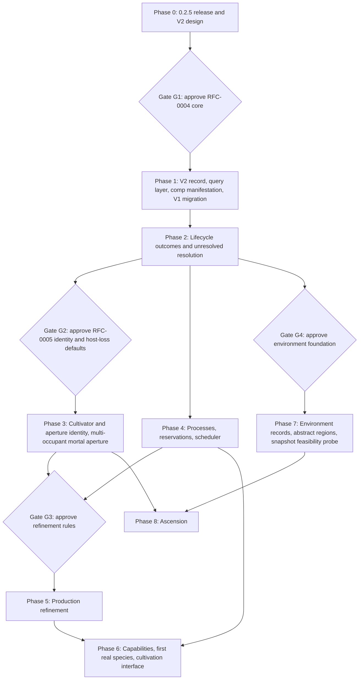

# Gu Framework V2 reconstruction plan

**Status** — Proposed. Each phase starts only after its approval gate.
**Architecture** — [RFC-0004](RFC-0004-GU-FRAMEWORK-V2.md) · [RFC-0005](RFC-0005-CULTIVATORS-REFINEMENT-APERTURES.md) · [RFC-0006](RFC-0006-PERSISTENT-IMMORTAL-ENVIRONMENTS.md) · [Assessment](V2-SYSTEM-ASSESSMENT.md) · [Engine evidence](ENGINE-1.7-GU-V2-INVESTIGATION.md)

## Dependency-aware roadmap

| Phase | Scope | Exit evidence |
|---|---|---|
| **0** | Record 0.2.5 acceptance, prepare the release, publish the V2 architecture, add `V2EngineProbe`. | This document set. Owner decision on the 0.2.5 merge. |
| **1** | `GuRecord` V2, pure `GuView` queries, reconciliation queue, `CompGuManifestation` with load-time self-registration, legacy classes as shells, V1 → V2 migrator, coordinator with V1 transaction mechanics. Ground and inventory moves stop being transitions. Remove the Gear guard. | All adapted Slice 3B profiles pass. `V2EngineProbe` shows no quarantine for downing, death, imprisonment, stripping or faction change. V1 checkpoint saves migrate. Benchmark ≤ V1 cost at 120 records. |
| **2** | Terminal outcomes from native hooks, `Unresolved` causes and policies, `TileAbstract` placement, world-pawn GC rule, operator recovery tools, tombstone retention. | `V2EngineProbe` records terminal outcomes for destruction and death and an unresolved, then resolved, outcome for map removal and world GC. Quarantine occurs only in the evidential cases. |
| **3** | `CultivatorRecord`, `ApertureRecord`, `guApertureId`, the multi-occupant `MortalAperture` container, host death and resurrection recovery, NPC retention. | Resurrection restores occupants. 120 hosts with 10 Gu each meet the benchmark budget. NPC with aperture survives GC and reload. |
| **4** | `GuProcess`, reservations, due-time scheduler, a developer test process. | Process survives reload mid-step, interruption outcomes, reservation conflicts. |
| **5** | Production refinement (RFC-0005 §5). | Owner gameplay acceptance. |
| **6** | Capability framework, Moonlight Gu as the first real species, the first cultivation interface. | Owner gameplay acceptance. |
| **7** | `EnvironmentRecord`, abstract regions, `ManifestationBoundary`, strategy C feasibility probe. | Probe report and owner decision on materialization strategy. |
| **8** | Ascension (RFC-0005 §8). | Owner gameplay acceptance. |

Ecology work such as feeding, regional cohorts and new habitats can proceed alongside phases 3–6 once phase 2 lands. Discretionary visual work stays frozen.

## Migration and regression verification plan

### Inputs

| Input | Purpose |
|---|---|
| Historical 31×31 and 39×39 saves | Pre-registry saves must load with an empty V2 registry and unchanged caverns. |
| V1 checkpoint saves in each custody state: wild, dormant ground, dormant inventory, aperture, released | Regenerated by the existing Slice 3B profiles at `8da9353`. Field-by-field migration checks. |
| V1 saves containing every quarantine reason | Generated by `Slice3B1` and `V2EngineProbe`. Checks reclassification into unresolved, rebinding, or retained quarantine. |
| The owner's acceptance colony, if the owner provides a copy | Real-play migration. |

Originals are copied into disposable test roots and their SHA-256 hashes are checked after each run, as Phase F established. Original saves are never modified.

### Automated gates per phase

1. `scripts/verify.ps1 -Focused`: structural checks, game-linked build, managed tests.
2. Managed migration tests: V1 XML fragments to V2 records, including missing Defs, a missing class and corrupt fields.
3. Native profiles: adapted `Slice3B1` to `Slice3B5B`, `VanillaGuInventory`, `V2EngineProbe`, `Awakening`, `Botanical`, `CargoPrototype`, `AutomaticHauling`, `Core`, `IdeologyOdyssey`, `IdeologyReset`, and the historical saves.
4. Two fresh-process reloads for every new stable state. Failure injection at each transaction boundary. Replay of each creation event key.
5. Performance: 120, 1,000 and 10,000 records, contained and manifested, with save size, load time, rebuild, scheduler and tick cost. Same hardware and method as the [0.2.5 benchmark](GU-FRAMEWORK-0.2.5-ACCEPTANCE.md#performance-methodology).
6. DLC passes for death, downing and discard hooks once phase 2 lands: Royalty, Biotech, Anomaly, Odyssey.

### Evidence labels

Every report separates static checks, stub-based tests, actual-assembly compilation, native fixtures, owner reports and independently reproduced game tests, as required by [AGENTS.md](../AGENTS.md).

### Downgrade policy

Saves written by V2 are not supported by V1 builds. The release notes will say so. Saves written by 0.2.5 load in V2.

## Owner decisions and approval gates

### Gate G0 — now

| # | Decision | Recommendation |
|---|---|---|
| D0.1 | Merge `feature/spirit-spring-ecology-visual-overhaul` into `main` as 0.2.5. | Approve after reviewing [the release notes](RELEASE-0.2.5.md). |
| D0.2 | Accept the development philosophy as recorded in [AGENTS.md](../AGENTS.md) and the [vision](PROJECT-VISION.md). | Approve. |

### Gate G1 — before phase 1

| # | Decision | Recommendation |
|---|---|---|
| D1.1 | Reconstruct the individual schema as V2 with migration. | Approve. V1 fails ordinary play. |
| D1.2 | The engine is authoritative for the physical location of manifested Gu. Ground and inventory become derived locations. | Approve. |
| D1.3 | Component-based manifestation with legacy classes kept as shells. | Approve. |
| D1.4 | Separate `Unresolved` from evidential quarantine. | Approve. |
| D1.5 | Remove the Gear guard and the special pickup transaction. | Approve. |
| D1.6 | Should dormant Gu become haulable to stockpiles? | Defer to playtesting after phase 1. |

### Gate G2 — before phase 3

| # | Decision | Recommendation |
|---|---|---|
| D2.1 | Default host-death outcomes for contained Gu. | Wait while the corpse exists, then apply a species `HostLoss` default. Pick the default (die, escape or remain). |
| D2.2 | Outcome for Gu on a removed map. | Abstract into tile custody for later recovery. Refined Gu follow their refiner's policy. |
| D2.3 | Tombstone retention. | Keep tombstones that guard uniqueness, replay or audits. Compact the rest after one in-game year. |
| D2.4 | Mortal aperture capacity basis. | Rank and aptitude. Numbers through balance review. |
| D2.5 | When NPC cultivators are generated and how many Gu they carry. | Defer until phase 3 design. |
| D2.6 | Should inventory Gu stay with a downed Pawn? | Keep the native drop. It is now harmless and readable. |

### Gate G3 — before production refinement

| # | Decision |
|---|---|
| D3.1 | Refinement costs, contest model and failure consequences. |
| D3.2 | Bond survival after the refiner's death and inheritance rules. |
| D3.3 | How far species may customize refinement, host loss and access routes. |

### Gate G4 — before environment work

| # | Decision |
|---|---|
| D4.1 | First environment loaded from day one or abstract first. |
| D4.2 | Time-flow behavior while the player is inside. |
| D4.3 | Succession and collapse rules. |
| D4.4 | Whether player-built content may dematerialize before a high-fidelity strategy passes. |
| D4.5 | Shared budget of loaded levels and environments. |

### Standing rules

- Changes that remove a feature, change gameplay or change a save key are presented to the owner first with alternatives, benefits, migration and cost.
- Routine fixes, diagnostics and verified preparatory work inside an approved phase proceed without separate approval.
- Merges into `main` require explicit owner authorization.
