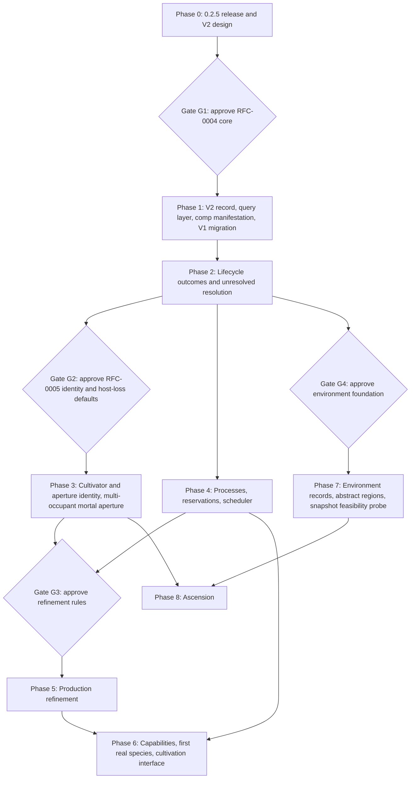

# Gu Framework V2 reconstruction plan

**Status** — Gate G0 and gate G1 approved by the owner after review of `98bf468`. Phase 1 is implemented, verified and accepted by the owner, including rendered acceptance ([journal](IMPLEMENTATION-V2.md)). Phase 2 is authorized with the owner decisions in [Phase 2 decisions](V2-PHASE2-OWNER-DECISIONS.md). Later gates remain open.
**Architecture** — [RFC-0004](RFC-0004-GU-FRAMEWORK-V2.md) · [RFC-0005](RFC-0005-CULTIVATORS-REFINEMENT-APERTURES.md) · [RFC-0006](RFC-0006-PERSISTENT-IMMORTAL-ENVIRONMENTS.md) · [Assessment](V2-SYSTEM-ASSESSMENT.md) · [Engine evidence](ENGINE-1.7-GU-V2-INVESTIGATION.md)

## Dependency-aware roadmap

| Phase | Scope | Exit evidence |
|---|---|---|
| **0** | Record 0.2.5 acceptance, prepare the release, publish the V2 architecture, add `V2EngineProbe`. | This document set. Owner decision on the 0.2.5 merge. |
| **1** | `GuRecord` V2 with independent facets, pure queries, reconciliation from events and a scheduled sweep, `CompGuManifestation` with load-time self-registration, legacy classes as loadable shells, transitional aperture identity (`guApertureId`), V1 → V2 migrator, coordinator reusing V1 transaction mechanics, adapted developer controls and underground protection. Ground and inventory moves stop being transitions. Remove the Gear guard only after the ordinary inventory fixtures pass on V2. | Adapted Slice 3B profiles pass with explained expectation changes. `V2EngineProbe` shows no quarantine for downing, death, imprisonment, stripping or faction change. Reads are pure. Rogue projections are rejected. V1 checkpoint saves migrate in every custody state. Historical saves load with unchanged hashes. 120-record benchmark compared with V1. |
| **2** | Terminal outcomes from native hooks and explicit operations, recoverable deceased-host custody, structured evidence, dormant Gu hauling, world-location placement with a configurable preservation policy, world-pawn GC rule, operator recovery tools, safe compaction, manifestation and DLC probes. | `V2EngineProbe` records terminal outcomes for destruction and death and an unresolved, then resolved, outcome for map removal and world GC. Quarantine occurs only in the evidential cases. |
| **3** | `CultivatorRecord`, `ApertureRecord`, `guApertureId`, the multi-occupant `MortalAperture` container, host death and resurrection recovery, NPC retention. | Resurrection restores occupants. 120 hosts with 10 Gu each meet the benchmark budget. NPC with aperture survives GC and reload. |
| **4** | `GuProcess`, reservations, due-time scheduler, a developer test process. | Process survives reload mid-step, interruption outcomes, reservation conflicts. |
| **5** | Production refinement (RFC-0005 §5). | Owner gameplay acceptance. |
| **6** | Capability framework, Moonlight Gu as the first real species, the first cultivation interface. | Owner gameplay acceptance. |
| **7** | `EnvironmentRecord`, abstract regions, `ManifestationBoundary`, strategy C feasibility probe. | Probe report and owner decision on materialization strategy. |
| **8** | Ascension (RFC-0005 §8). | Owner gameplay acceptance. |

Ecology work such as feeding, regional cohorts and new habitats can proceed alongside phases 3–6 once phase 2 lands. Discretionary visual work stays frozen.

## Migration and regression verification plan

### Inputs

| Input | Purpose |
|---|---|
| Historical 31×31 and 39×39 saves | Pre-registry saves must load with an empty V2 registry and unchanged caverns. |
| V1 checkpoint saves in each custody state: wild, dormant ground, dormant inventory, aperture, released | Regenerated by the existing Slice 3B profiles at `8da9353`. Field-by-field migration checks. |
| V1 saves containing every quarantine reason | Generated by `Slice3B1` and `V2EngineProbe`. Checks reclassification into unresolved, rebinding, or retained quarantine. |
| The owner's acceptance colony, if the owner provides a copy | Real-play migration. |

Originals are copied into disposable test roots and their SHA-256 hashes are checked after each run, as Phase F established. Original saves are never modified.

### Automated gates per phase

1. `scripts/verify.ps1 -Focused`: structural checks, game-linked build, managed tests.
2. Managed migration tests: V1 XML fragments to V2 records, including missing Defs, a missing class and corrupt fields.
3. Native profiles: adapted `Slice3B1` to `Slice3B5B`, `VanillaGuInventory`, `V2EngineProbe`, `Awakening`, `Botanical`, `CargoPrototype`, `AutomaticHauling`, `Core`, `IdeologyOdyssey`, `IdeologyReset`, and the historical saves.
4. Two fresh-process reloads for every new stable state. Failure injection at each transaction boundary. Replay of each creation event key.
5. Performance: 120, 1,000 and 10,000 records, contained and manifested, with save size, load time, rebuild, scheduler and tick cost. Same hardware and method as the [0.2.5 benchmark](GU-FRAMEWORK-0.2.5-ACCEPTANCE.md#performance-methodology).
6. DLC passes for death, downing and discard hooks once phase 2 lands: Royalty, Biotech, Anomaly, Odyssey.

### Evidence labels

Every report separates static checks, stub-based tests, actual-assembly compilation, native fixtures, owner reports and independently reproduced game tests, as required by [AGENTS.md](../AGENTS.md).

### Downgrade policy

Saves written by V2 are not supported by V1 builds. The release notes will say so. Saves written by 0.2.5 load in V2.

## Owner decisions and approval gates

### Gate G0 — now

| # | Decision | Recommendation |
|---|---|---|
| D0.1 | Merge `feature/spirit-spring-ecology-visual-overhaul` into `main` as 0.2.5. | **Approved.** Merged as `229df4e` and tagged `v0.2.5`. Outstanding manual checks deferred and still open. |
| D0.2 | Accept the development philosophy as recorded in [AGENTS.md](../AGENTS.md) and the [vision](PROJECT-VISION.md). | **Approved.** |

### Gate G1 — before phase 1

| # | Decision | Recommendation |
|---|---|---|
| D1.1 | Reconstruct the individual schema as V2 with migration. | **Approved.** |
| D1.2 | The engine is authoritative for the physical location of manifested Gu. Ground and inventory become derived locations. | **Approved**, with commit-time revalidation (RFC-0004 §15.1). |
| D1.3 | Component-based manifestation with legacy classes kept as shells. | **Approved.** |
| D1.4 | Separate `Unresolved` from evidential quarantine. | **Approved**, with RFC-0004 §15.4. |
| D1.5 | Remove the Gear guard and the special pickup transaction. | **Approved conditionally.** Remove after the replacement passes the ordinary inventory fixtures. Keep right-click pickup. |
| D1.6 | Should dormant Gu become haulable to stockpiles? | **Approved** for Phase 2 (2026-11-22). Hauling keeps the same manifestation and revisions and never changes allegiance. |

### Gate G2 — before phase 3

| # | Decision | Recommendation |
|---|---|---|
| D2.1 | Default host-death outcomes for contained Gu. | **Direction approved** (2026-11-22): host death leaves aperture Gu recoverable from the deceased, physical Gu survive their holder, deliberate destruction is a future behavior. Species defaults for corpse destruction and host disappearance remain open. |
| D2.2 | Outcome for Gu on a removed map. | **Direction approved** (2026-11-22): configurable preservation policy. Rare, unique and important Gu keep identity in world-location custody. Common wild Gu may return to populations or retire under declared accounting. Policy values need approval. |
| D2.3 | Tombstone retention. | **Approved** (2026-11-22): about one in-game year for ordinary history. Integrity information is kept while needed. |
| D2.4 | Mortal aperture capacity basis. | Rank and aptitude. Numbers through balance review. |
| D2.5 | When NPC cultivators are generated and how many Gu they carry. | Defer until phase 3 design. |
| D2.6 | Should inventory Gu stay with a downed Pawn? | Keep the native drop. Physical Gu survive the holder's death (approved 2026-11-22). |

### Gate G3 — before production refinement

| # | Decision |
|---|---|
| D3.1 | Refinement costs, contest model and failure consequences. |
| D3.2 | Bond survival after the refiner's death and inheritance rules. |
| D3.3 | How far species may customize refinement, host loss and access routes. |

### Gate G4 — before environment work

| # | Decision |
|---|---|
| D4.1 | First environment loaded from day one or abstract first. |
| D4.2 | Time-flow behavior while the player is inside. |
| D4.3 | Succession and collapse rules. |
| D4.4 | Whether player-built content may dematerialize before a high-fidelity strategy passes. |
| D4.5 | Shared budget of loaded levels and environments. |

### Standing rules

- Changes that remove a feature, change gameplay or change a save key are presented to the owner first with alternatives, benefits, migration and cost.
- Routine fixes, diagnostics and verified preparatory work inside an approved phase proceed without separate approval.
- Merges into `main` require explicit owner authorization.

### Phase 2 decisions still required

Raised by the Phase 2 implementation. Each has a provisional engineering default that is safe to keep until the owner decides. [Phase 2 report](IMPLEMENTATION-V2.md#phase-2--lifecycle-outcomes-recovery-and-hauling)

| # | Decision | Current provisional behavior | Recommendation |
|---|---|---|---|
| D2.7 | Species host-loss outcomes when a cultivator's corpse is destroyed or the host disappears (`Die`, `Escape`, `Remain`). | `Unresolved(HostCorpseDestroyed)` with the corpse's location. Nothing is invented. | Owner ruled out Gu slipping out of a dead host on their own. Remaining choice when the body itself is destroyed: the Gu `Remain` at the location as a world-location record, or `Die`. Recommendation: `Remain` for rare and refined Gu. |
| D2.8 | Preservation policy values per species. | Every species defaults to `Individual`. Rank 6 and above, unique and refined Gu always stay individual. | Keep `Individual` for rare species. Set common species to `ReturnToPopulation` once regional populations exist. |
| D2.9 | Regional population target for `ReturnToPopulation`. | Unresolved with evidence. Active Gu stay retained world Pawns. | Design with the regional ecology work. Credit the regional cohort with an idempotent event. |
| D2.10 | Tombstone deletion. | Tombstones are compacted after one year and never deleted. | Keep compaction. Approve deletion only with a compact event ledger for creation keys, terminal keys and debits. |
| D2.11 | A dead wild Gu Pawn revived by native resurrection. | The record stays `Died`. A revived Pawn is never authorized and is reported as a rogue projection on load. | Keep death terminal. A species may later declare revival as an explicit operation. |
| D2.12 | Physical Gu of a destroyed corpse or vanished holder. | Placed where the body stood. Otherwise handled by the preservation policy. | Confirm. It follows "physical Gu survive their holder". |
| D2.13 | Anomaly gate on development dormancy, release and materialization. | Replaced by a per-Pawn check for mutants, creepjoiners, duplicates, unnatural corpses and hypnosis. | Confirm after the native Anomaly runs recorded in the report. |
